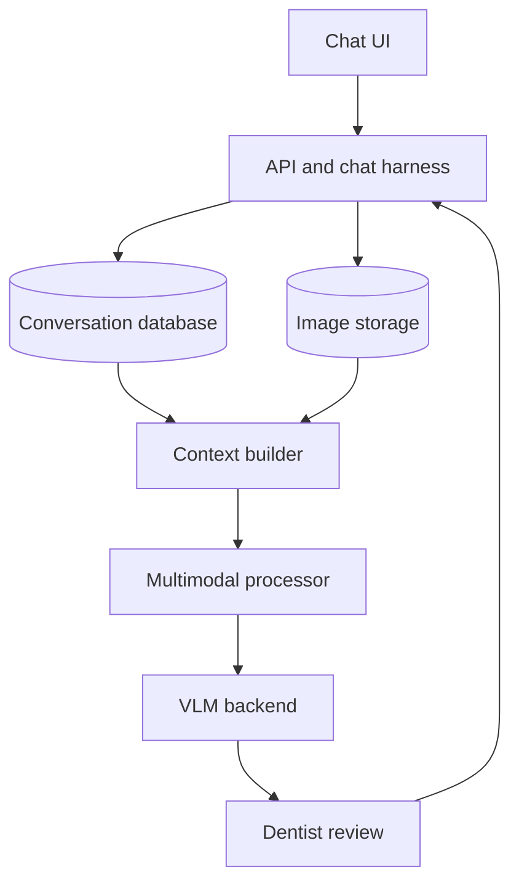
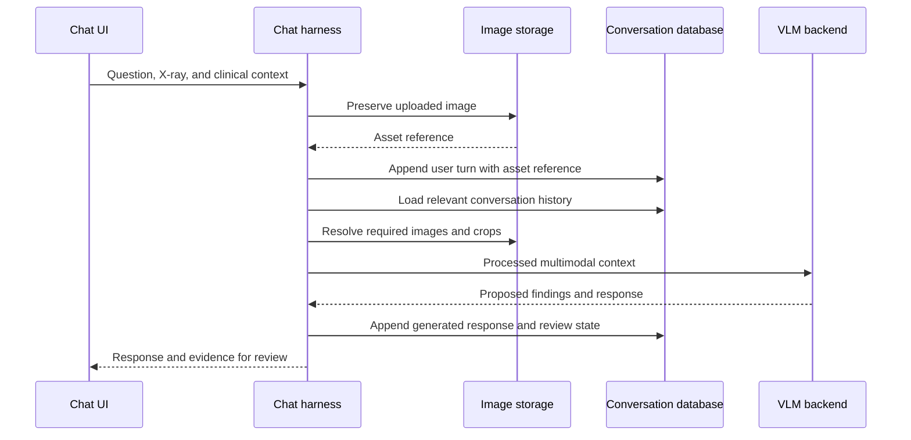
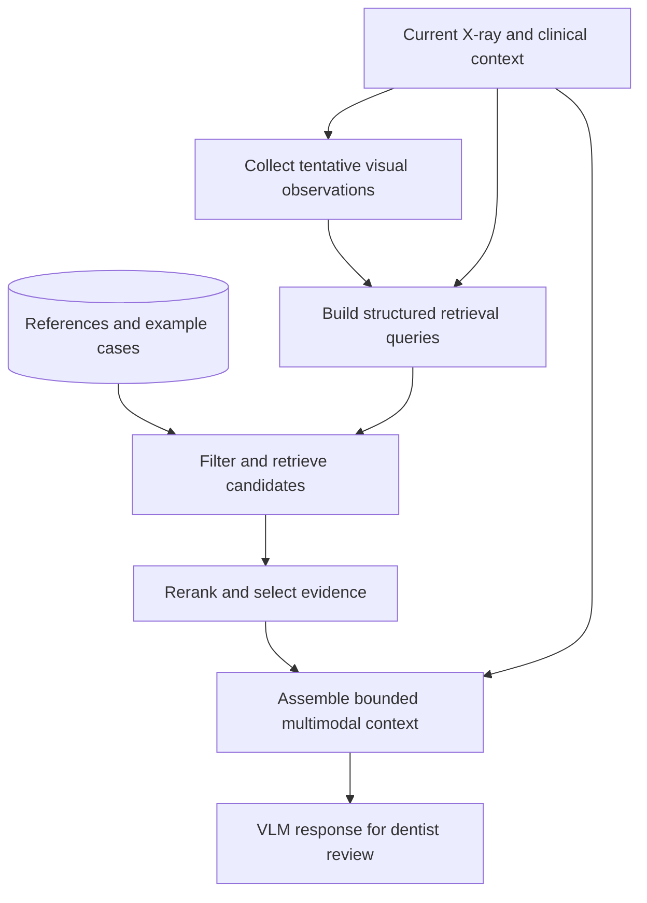

# Self-hosted VLM chatbot for dentistry — discussion export

**Discussion date:** 23 October 2026  
**Purpose:** Preserve our discussion as an organized reference for building and evaluating a dental chatbot that combines X-rays and clinical text. This is a synthesis of the conversation, rather than a verbatim transcript.

## 1. Project direction and current status

The deployment goal changed from a text-only LLM service to a **self-hosted VLM chatbot**. A doctor should be able to upload dental X-rays, provide descriptions or clinical context, ask questions, and continue the conversation about earlier images.

| Item | What we established |
| --- | --- |
| Target hardware | User-described NVIDIA “2080, 11 GB”; exact GPU SKU and software compatibility remain to be confirmed |
| Initial imaging inputs | Both panoramic X-rays and intraoral bitewing/periapical X-rays |
| Desired scope | Common dental diagnoses/findings; the precise first set of tasks remains open |
| Text inputs | Doctor descriptions, clinical history, examination findings, questions, and conversation history |
| Existing private dataset | None available |
| Dataset strategy | Start with public dental datasets, including ones with clinical records and ones with localized findings |
| Knowledge-base direction | User wants retrieval over a knowledge base, potentially using vectors and a graph, to select suitable context and improve measured performance |
| Proposed clinical role | Dentist-reviewed assistance with observations, candidate interpretations, and draft reports |
| Model selection | Candidates identified; no final checkpoint selected or clinically validated |
| Implementation status | Learning scripts and a shared Python environment exist; the clinical chatbot and deployment service are proposed work |

The recommendation throughout the discussion was to distinguish **being able to run a VLM** from **having evidence that it performs the intended dental task reliably**. No dental diagnostic accuracy or 11 GB deployment benchmark has been measured in this project.

## 2. Can a VLM also function as a normal LLM?

Yes. General-purpose models such as Qwen2.5-VL and Qwen3-VL support ordinary text-only conversations alongside image-plus-text requests. A user does not need to attach an image to every message. [Supported model inputs](https://docs.vllm.ai/en/stable/models/supported_models/)

The conceptual paths are:

```text
Text only:
Text -> text embeddings -> language decoder -> text answer

Image + text:
Image -> vision encoder -> visual embeddings --+
Text  -> text embeddings -----------------------+-> language decoder -> text answer
```

For a text-only request, Qwen can skip image encoding. In a deployment retaining both capabilities, the vision weights normally remain loaded. [Qwen2.5-VL implementation](https://github.com/huggingface/transformers/blob/v4.57.6/src/transformers/models/qwen2_5_vl/modeling_qwen2_5_vl.py)

This means one VLM service can handle ordinary chat, text summarization, questions about an image, and document/image-based extraction. Text capability and quality still need evaluation: adding visual support does not guarantee stronger writing, coding, or reasoning than a dedicated text model.

For the dental product, a single VLM is a reasonable initial conversational backend. Separate models can be introduced when a specific capability or measured performance requirement justifies them.

## 3. VLM architecture concepts behind the chatbot

We started with small experiments to understand the architecture before loading a pretrained model:

1. **Patching:** Divide an image into non-overlapping patches.
2. **Patch embedding:** Project each patch into a vector. A Conv2d with kernel and stride equal to patch size can implement the same operation as flattening each patch and applying a Linear layer.
3. **Vision attention and position:** Exchange information between patches while representing their spatial arrangement.
4. **Spatial merger/projector:** Combine neighboring features and project them to the language decoder's embedding width.
5. **Multimodal sequence:** Replace image-placeholder embeddings with continuous visual vectors in the formatted conversation.
6. **Alignment:** Train the visual and language components to make those vectors meaningful to the decoder.

Matching image-vector and text-vector dimensions makes their tensors compatible. Learned alignment makes their meanings compatible.

The simplified Qwen2.5-VL static-image example discussed was:

```text
448 x 448 processed image
    -> 14 x 14 spatial patches
    -> 32 x 32 = 1,024 patch features
    -> 2 x 2 spatial merger
    -> 256 visual tokens
```

Its temporal patch dimension is a separate consideration: static-image preprocessing duplicates the frame to form the temporal patch input. The spatial factor of 28 in this static-image token calculation comes from spatial patch size 14 multiplied by spatial merge size 2. [Image preprocessing source](https://github.com/huggingface/transformers/blob/v4.57.6/src/transformers/models/qwen2_vl/image_processing_qwen2_vl.py)

For already-processed static images whose dimensions satisfy the required grid constraints:

```text
visual tokens = H * W / (28 * 28)
```

Doubling both image dimensions produces four times as many patches/visual tokens. A full dense attention score matrix would have sixteen times as many elements. Qwen uses a combination of window and full vision attention, and efficient attention implementations can avoid materializing the complete dense matrix. These counts are useful for budgeting, rather than a complete VRAM prediction.

## 4. What the chatbot harness must do

The harness is the application layer around the VLM. It owns conversation storage, uploaded assets, evidence selection, input formatting, execution, and recording results.

The model receives the context assembled for the current request. Storing an image in a database or mentioning its filename does not itself make that image available to the model.

### Component responsibilities

| Component | Responsibility |
| --- | --- |
| Chat UI | Collect questions, images, clinical descriptions, and follow-up messages |
| API/harness | Associate messages and assets with the correct conversation; coordinate execution |
| Image storage | Preserve original uploads and any derived views/crops |
| Conversation database | Store ordered turns, content blocks, asset references, and responses |
| Context builder | Select relevant history and evidence within the context budget |
| Model processor | Apply image preprocessing and the checkpoint's multimodal chat template |
| VLM backend | Generate observations, interpretations, or conversational responses |
| Review workflow | Let a dentist inspect evidence and correct or accept proposed findings |



This is a proposed application structure. It is not a diagram of services already implemented or running in this workspace.

### Store heterogeneous content as ordered blocks

One user message can contain text, an image, more text, and another image. Keep that ordering and the identity of each attachment.

An application-level record could look like:

```json
{
  "conversation_id": "chat_123",
  "role": "user",
  "content": [
    {"type": "text", "text": "Here is the first radiograph."},
    {"type": "image_ref", "asset_id": "image_A"},
    {"type": "text", "text": "Assess the region described in the clinical notes."}
  ]
}
```

`image_ref` is an internal application format. Before inference, the harness resolves it to actual image data or a media reference supported by the backend. It is not a model API field to pass through unchanged.

Useful asset metadata includes ownership, conversation association, original dimensions, image/view type, upload turn, and any document/page identity. Preserve originals when generating resized views or crops.

### Request lifecycle



The model-specific processor converts selected text and images into tensors. For Qwen through Transformers, these can include `input_ids`, `attention_mask`, `pixel_values`, and `image_grid_thw`. Use the checkpoint's processor/chat template rather than inventing image-placeholder formatting. [Multimodal chat templates](https://huggingface.co/docs/transformers/v4.57.1/en/chat_templating_multimodal)

## 5. Keeping context across turns

Consider this generic image conversation:

```text
User:      [image A] What can you observe here?
Assistant: ...
User:      What about the area on the left?
```

The backend retrieves image A and assembles it with the relevant conversation for the follow-up. The user does not have to upload it again.

Keeping only the assistant's previous description can lose details and propagate an earlier mistake. A follow-up that requires new visual inspection should have the original image or an appropriate crop represented in the current model context.

For multiple uploads:

- Preserve stable identities such as `image_A` and `image_B`.
- Keep each image associated with its originating turn and description.
- Include both when the user asks for a comparison.
- Clarify ambiguous references such as “that image” when more than one interpretation is plausible.

### Three different kinds of memory

| Layer | Stored content | Role |
| --- | --- | --- |
| Durable conversation memory | Messages, original images, asset references, generated responses, review corrections | Reconstruct the conversation |
| Derived/searchable memory | OCR, summaries, extracted findings, retrieval indexes | Find relevant evidence as the collection grows |
| Runtime caches | Image/encoder computation and decoder KV state, where supported | Reuse inference computation |

Cache eviction should affect performance, while durable storage preserves the ability to reconstruct a request. A decoder KV cache is not a permanent patient record. Backend cache support and validity rules must be verified for the selected serving engine. [vLLM multimodal inputs and caching](https://docs.vllm.ai/en/stable/features/multimodal_inputs/)

### Context budgeting

Start with a bounded conversation that includes the relevant images. Before generation, account for text, visual tokens, and reserved output tokens.

As conversations grow:

1. Keep the current question and relevant recent turns.
2. Retrieve older images or pages needed for the question.
3. Summarize older discussion while retaining asset references.
4. Reload original visual evidence when a new question depends on fine detail.

Summaries and OCR can help select evidence, but may omit visual details. The initial conversation-only prototype can operate without a vector database. The user's revised direction adds a knowledge base for evidence selection and knowledge-supported interpretation; see Section 15.

## 6. Can the VLM generate images?

Some multimodal models support both understanding and image generation. However, the Qwen2.5-VL and Qwen3-VL models discussed here produce text responses from text/image inputs; they do not natively generate image files. [Qwen3-VL model card](https://huggingface.co/Qwen/Qwen3-VL-4B-Instruct)

Janus-Pro was mentioned as an example of a model family supporting both understanding and visual generation, not as the selected dental deployment model. [Janus documentation](https://github.com/deepseek-ai/Janus)

A single chatbot interface could expose several backends:

| User request | Capability |
| --- | --- |
| Explain an uploaded image | VLM image understanding |
| Draw an illustration | Image-generation tool |
| Edit an uploaded image | Image-editing tool with the source image |

Generated images should be stored as conversation assets when follow-up references are supported. Image generation is not needed for the first dental interpretation workflow; generated illustrations must remain distinguishable from original clinical images.

## 7. Multiple models, routing, and intent detection

The discussion distinguished **model routing** from **tool orchestration**:

| Mechanism | Decision |
| --- | --- |
| Model routing | Which main model should handle a request? |
| Tool orchestration | Which extra capabilities should the conversation invoke, and in what order? |

OpenAI publicly documents a main conversational model deciding to call a specialized image-generation model through a tool. This illustrates the architecture pattern without establishing ChatGPT's complete internal deployment or private routing logic. [Official image-generation tool documentation](https://developers.openai.com/api/docs/guides/tools-image-generation)

A separate intent-detection model is optional. The alternatives discussed were:

1. **Rules or explicit UI choices:** Suitable for clear operations, such as an image-generation button.
2. **A separate small classifier:** Useful when routing among several backends is frequent and its cost/latency benefit is measured.
3. **The main conversational model:** A model with reliable tool calling can answer directly or request a tool.

Routing needs the user's intent and relevant history. An attachment alone does not establish whether the user wants description, comparison, extraction, or editing. “Make it brighter” depends on which earlier asset is being referenced.

The initial dental workflow can use one VLM without a separate intent classifier. Additional tools or specialist models can be introduced for specific measured needs. Each receives the relevant evidence in its own supported format; different models do not automatically share conversation memory or compatible internal embeddings.

## 8. Dental workflow and clinical boundaries

The user's goal is interpretation of dental pathology using both X-rays and doctor-provided descriptions. The proposed first product is a dentist-reviewed assistant, with an explicit separation between:

- Observations attributed to the image.
- Information supplied by the doctor.
- Candidate interpretations requiring review.
- Image limitations and missing information.

A practical proposed sequence is:

1. Preserve and prepare the original image, including orientation and controlled resizing.
2. Where appropriate, provide an overview and selected tooth-region crops.
3. Structure symptoms, history, examination findings, and suspected diagnoses in separate fields.
4. Label the doctor's suspected diagnosis as a hypothesis rather than an image observation.
5. Assemble images and text with the specific question.
6. Generate a structured response.
7. Let a dentist inspect the evidence and correct or accept findings.

The proposed output contract was:

```text
image_quality
image_observations
doctor_reported_information
candidate_interpretations
supporting_regions
limitations_or_missing_information
review_status
```

Localization and tooth numbering also require validation. A generated box or tooth number is not automatically verified evidence. Model-written confidence percentages should not be treated as calibrated clinical probabilities without evaluation.

### Why dental validation is essential

A study of two multimodal models on pediatric panoramic tooth identification found performance insufficient for clinical application, including inconsistent results. It evaluated specific models and a specific task; it does not prove that every dental VLM behaves identically. It does demonstrate why general conversational capability is insufficient evidence of dental competence. [Study](https://pmc.ncbi.nlm.nih.gov/articles/PMC12783444/)

The proposed first evaluation scope is a small, explicitly defined set of findings on specified image types. “Common diagnoses” remains too broad to serve as an evaluation specification.

Candidate starting findings discussed were caries, periapical lesions, impacted teeth, and alveolar bone loss, with different datasets and annotations supporting different tasks. Performance should be reported by task and image type rather than collapsed into an unsupported claim of general diagnostic ability.

## 9. Models and the 11 GB constraint

| Candidate | Why it was discussed | Unresolved considerations |
| --- | --- | --- |
| Qwen2.5-VL-3B-Instruct, 4-bit | Small general-purpose image/text baseline compatible with the existing learning stack | Dental accuracy, actual target-GPU memory use, preprocessing, and quantization effects |
| Qwen3-VL small variants | Alternative general-purpose VLM family with text and visual input support | Specific checkpoint/version choice and target-stack compatibility |
| DentVLM | Dental-specific research comparator | Larger model, access/license conditions, quantized deployment feasibility, and external validation |

DentVLM is based on Qwen2-VL-7B. Its released weights are CC BY-NC 4.0 and its model card excludes use as the sole basis for clinical decisions. The existence of a dental-specific model does not establish that its quantized version fits this GPU or works reliably in the user's clinical setting. [DentVLM model card](https://huggingface.co/ZJU-AI4H/DentVLM), [research paper](https://www.nature.com/articles/s41467-026-75718-x)

Four-bit quantization reduces eligible weight storage. Total inference memory also includes unquantized components, visual processing, KV cache, activations, and workspaces. [Transformers quantization documentation](https://huggingface.co/docs/transformers/v4.57.1/en/quantization/bitsandbytes)

The proposed approach for the target machine is:

- Confirm the exact GPU model and supported attention/precision backends.
- Start with one request at a time and a small VLM candidate.
- Bound image tokens, conversation length, and output length.
- Measure peak memory with representative X-rays and crops.
- Check accuracy after resizing and quantization.
- Treat fine-tuning memory requirements separately from inference requirements.

No exact VRAM fit or throughput was promised. The full dataset lives on disk; GPU memory is primarily determined by the model and the active batch/context.

## 10. Public datasets identified

The following dataset records were checked during the discussion. Counts, access terms, and licensing refer to the cited releases. Public availability does not imply unrestricted commercial use.

| Dataset | Modality and size | Annotations/content | Proposed role | Published license |
| --- | --- | --- | --- | --- |
| [COde](https://huggingface.co/datasets/zirak-ai/COde) | Authors report 8,775 checkups from 4,800 patients, 8,056 radiographs, and 50,000 intraoral photographs | Linked clinical records, diagnoses, treatment/follow-up information; CSV/JSON and ShareGPT representations described in the paper | Closest match to image-plus-clinical-context conversations | CC BY 4.0, with accompanying data-use agreement |
| [DENTEX](https://huggingface.co/datasets/ibrahimhamamci/DENTEX) | 1,005 panoramic X-rays in the diagnosis-annotated subset; additional partially labelled/unlabelled subsets | Abnormal-tooth localization, tooth numbering, caries, deep caries, periapical lesions, impacted teeth | A bounded panoramic detection/localization benchmark | CC BY-NC-SA 4.0 |
| [Dental caries in bitewing radiographs](https://data.mendeley.com/datasets/4fbdxs7s7w/1) | 100 bitewing radiographs | Caries bounding boxes from eight dentists, supplied as COCO JSON | Small bitewing evaluation set and study of annotator disagreement | CC BY-NC 3.0 |
| [DenPAR](https://zenodo.org/records/16645076) | Intraoral periapical radiographs | Tooth segmentation/boxes and bone-level, CEJ, and apex landmarks | Alveolar bone-loss measurement development/evaluation | CC BY 4.0, confirmed through repository metadata |
| [Hanoi Medical University periapical-lesion dataset](https://data.mendeley.com/datasets/kx52tk2ddj/3) | 3,926 original panoramic X-rays plus augmented versions | Periapical-lesion annotations | Periapical-lesion detection experiments | CC BY 4.0 in the linked version 3 record |

The initial dataset recommendation was **COde plus DENTEX**, adding bitewing and bone-loss evaluation as the task scope expands. These datasets have complementary purposes; they should not be merged under one assumed annotation scheme.

### COde: the closest match to the chatbot inputs

The authors describe linked images and visit-level clinical records, including medical histories, diagnoses, treatment plans, and follow-up notes. The paper describes ready-to-use ShareGPT data as well as original records. [Paper](https://pmc.ncbi.nlm.nih.gov/articles/PMC13338166/)

Use the complete release on [Hugging Face](https://huggingface.co/datasets/zirak-ai/COde); the [GitHub repository](https://github.com/zirak-ai/COde) states that it shares only the textual portion. The Hugging Face file listing contains a dataset ZIP and a [data-use agreement](https://huggingface.co/datasets/zirak-ai/COde/blob/main/Data%20Usage%20Agreement.pdf).

For an X-ray-only task, filter and evaluate the appropriate cases. Diagnoses derived from full clinical records, photographs, and examinations should not all be treated as findings visible on an X-ray. The paper describes disease labels extracted from clinician reports and checked for agreement with those reports, rather than an independent re-diagnosis of every case.

### DENTEX: a bounded visual benchmark

The diagnosis-annotated subset is split into 705 training, 50 validation, and 250 test images. The official documentation now states that all ground-truth data are available. Preserve its published test split for benchmark comparisons and inspect the release's actual files before constructing a loader. [Official documentation](https://huggingface.co/datasets/ibrahimhamamci/DENTEX)

The additional quadrant-only and tooth-enumeration subsets do not have the same disease-label coverage as the diagnosis subset.

### Access and license notes

- “NC” denotes non-commercial terms. Do not assume these releases permit a later commercial clinical product.
- DenPAR's CC BY 4.0 metadata was checked using its [Zenodo record API](https://zenodo.org/api/records/16645076).
- The linked Hanoi dataset version 3 record states CC BY 4.0; use the license for the actual release obtained rather than a secondary dataset list.
- Official records and metadata were reviewed. Bulk image archives were not downloaded or audited during this discussion.

## 11. Dataset preparation and validation rules

### Prevent leakage

1. Split by patient where identifiers are available. Keep all visits and views of the same patient together.
2. Keep an original image, its crops, and its augmented versions in the same split.
3. Keep diagnosis and treatment outcomes out of the input when they are prediction targets. Restrict inputs to information available at the intended point of use.
4. Keep generated QA variants of the same case together.
5. Preserve an untouched evaluation set and any published benchmark split used for comparisons.

The Hanoi dataset includes augmented copies. They are not independent patients or independent original radiographs.

### Respect label coverage

- Do not label every unannotated tooth or region as healthy.
- Check whether a release labels lesions, entire abnormal teeth, anatomical structures, or report-level diagnoses.
- Keep panoramic, bitewing, and periapical results separate during evaluation.
- Retain provenance when converting annotations into question-answer examples.
- Treat automatically generated explanations or synthetic clinical descriptions as generated data, rather than dentist-authored truth.

### Evaluate visual contribution and clinical errors

The proposed checks were:

| Check | Question it answers |
| --- | --- |
| Image-only, text-only, and combined inputs | Does the system use the image, or mainly reproduce the clinical text? |
| Per-condition sensitivity and specificity | Which findings are missed or incorrectly proposed? |
| Localization and tooth-number accuracy | Does the claimed finding refer to the correct evidence region/tooth? |
| Unsupported finding rate | Does the response introduce observations absent from the evidence? |
| Repeatability | Do identical inputs produce materially inconsistent findings? |
| Quantized versus reference inference | Does compression change the task's error profile? |
| Different devices, sites, and image quality | Does performance transfer beyond the source dataset? |
| Dentist review | Are findings and explanations useful and clinically appropriate? |

Report similarity or fluent wording alone does not establish diagnostic correctness. Keep limitations, missing evidence, and review status visible in the product.

## 12. Existing workspace and learning materials

### What has already been implemented

The [VLM learning lab](vlm-lab/README.md) contains:

| File | Concept |
| --- | --- |
| [01_patch_embedding.py](vlm-lab/01_patch_embedding.py) | Patches, projection equivalence, and reconstruction |
| [02_attention_and_position.py](vlm-lab/02_attention_and_position.py) | Attention and spatial position |
| [03_spatial_merger.py](vlm-lab/03_spatial_merger.py) | Correct grouping of spatial neighbors |
| [04_multimodal_sequence.py](vlm-lab/04_multimodal_sequence.py) | Visual placeholder replacement and causal information flow |
| [05_learn_alignment.py](vlm-lab/05_learn_alignment.py) | Learning a projector between frozen feature spaces |
| [06_resolution_budget.py](vlm-lab/06_resolution_budget.py) | Analytical token and selected memory estimates |
| [07_qwen_internals.py](vlm-lab/07_qwen_internals.py) | Real Qwen preprocessing and a tiny randomly initialized vision encoder |

All seven were run successfully on CPU during this conversation. They do not download pretrained weights or evaluate dental pathology. The color-alignment experiment improved from 0% to 100% on held-out samples from its simple three-color task; that result demonstrates alignment learning, not dental or general visual reasoning ability.

### Shared uv environment

At the user's request, Nano-vLLM, the quantization lab, and the VLM lab were consolidated into one root `.venv` and `uv.lock`. Their former environment paths link to the root environment. Duplicate Nano-vLLM and quantization environments were removed after verification.

The advanced Triton tutorials retain their own environment because their pinned PyTorch 2.14.1/Triton 3.8.0 requirements conflict with the shared PyTorch 2.6.0/Triton 3.2.0 inference stack.

The shared environment includes Transformers 4.57.6, accelerate, bitsandbytes, plotting tools, pytest, and editable Nano-vLLM. Its setup helper prepares a checksum-verified FlashAttention wheel. See the [workspace README](README.md) and [root dependency configuration](pyproject.toml).

From the workspace root:

```bash
# Prepare the pinned wheel and synchronize the shared environment.
python setup_env.py

# Run all VLM architecture lessons.
uv run --locked python vlm-lab/run_all.py --qwen

# Run the existing Nano-vLLM test discovery.
uv run --locked python -m unittest discover -s nano-vllm/tests -v
```

The migration verification included all seven VLM lessons and seven passing Nano-vLLM CPU tests; eighteen GPU tests were skipped because they are opt-in. Shared imports of PyTorch, FlashAttention, Transformers, bitsandbytes, and editable Nano-vLLM were also checked.

These checks took place in the current workspace environment. They are not verification of deployment compatibility on the user's separate 11 GB target GPU. Recheck GPU architecture, attention kernels, precision, driver support, and memory on that machine.

### What changes from the original text-only deployment plan

The existing [LLM deployment guide](LLM_INFERENCE_DEPLOYMENT.md) describes a proposed service around the workspace's Nano-vLLM implementation. The current [model runner](nano-vllm/nanovllm/engine/model_runner.py) loads the Qwen3 text architecture. A VLM checkpoint cannot be enabled merely by changing the model ID.

The proposed migration path is pretrained VLM inference through Transformers first, followed by selection and validation of an appropriate serving backend. Reuse the lessons about caching, batching, quantization, request ownership, monitoring, and deployment, while adding image preprocessing, visual-token budgeting, and multimodal context handling.

No clinical HTTP service, image upload endpoint, patient database, model fine-tuning, or dental benchmark execution has been completed as part of this discussion.

## 13. Recommended next steps

These are proposals for continuing the project, not completed tasks or commitments to measured results.

1. **Define the first evaluation task.** Specify findings and acceptable input types, rather than a general “common diagnoses” target.
2. **Inspect selected dataset releases.** Start with COde and DENTEX; verify image/text linkage, annotation coverage, patient identity fields, and access terms.
3. **Create a dataset manifest and protected split.** Record source, patient/case identity, modality, image paths, input clinical fields, targets, and provenance.
4. **Establish a small-model inference baseline.** Try the proposed quantized VLM candidate with controlled inputs and measure memory on the actual target GPU.
5. **Build the minimal chat harness.** Add original-image storage, structured conversation messages, evidence resolution, and model-specific processing.
6. **Measure performance before fine-tuning.** Compare image-only, text-only, and combined inputs against held-out labels and dentist review.
7. **Choose an adaptation strategy from the errors.** Options include VLM fine-tuning, a specialist detector/segmenter plus a conversational model, or a dental-specific research comparator.
8. **Validate any deployment configuration.** Re-evaluate after quantization, resizing, cropping, or backend changes, and retain clinician review.

Following the knowledge-base discussion, add a curated retrieval baseline and compare it with the same model without retrieval. Section 15 describes the proposed storage boundaries, context selection, and comparison plan.

## 14. Open questions

- What is the exact GPU SKU, driver, CUDA environment, operating system, and system RAM on the target machine?
- Which precise findings should version one support, and for which image types?
- Is the intended use personal learning, non-commercial research, or eventual commercial clinical deployment?
- Can a dentist review an evaluation subset and adjudicate disagreements?
- Which clinical text will actually be available at inference time?
- What conversation languages are required?
- What image dimensions and number of attachments per request are typical?
- What are the required latency, concurrency, and output-format targets?
- Which dataset license and annotation restrictions affect the intended use?
- Will a single VLM meet the measured requirements, or should a specialist visual model be added?

The central unresolved decision is the **first validated dental task**. Model choice, training data preparation, memory budgeting, and the production workflow should be selected around that task.

## 15. Revised direction: knowledge-supported interpretation with a small VLM

The user expects a small local VLM to have limited precision and wants a knowledge base, vector retrieval, and potentially a graph to supply relevant context. The proposed system should therefore evaluate both **visual performance** and **knowledge-supported interpretation**, with separate measurements of their errors.

### What retrieval can improve, and what needs separate work

| Failure or need | Proposed mechanism | Limit |
| --- | --- | --- |
| Missing dental reference knowledge | Retrieve curated descriptions, terminology, and supporting evidence | Retrieval quality and source quality must be measured |
| Too much irrelevant context | Filter, combine lexical/semantic retrieval, rerank, and enforce a context budget | More retrieved material can introduce distraction or contradiction |
| Relationships across symptoms, findings, anatomy, and conditions | Use structured records and, where useful, source-backed graph traversal | A graph association is not proof of a patient diagnosis |
| Missed or misread visual findings | Validate crops, preprocessing, domain adaptation, or a specialist detector/measurement model | Text retrieval does not establish that the model correctly inspected the X-ray |
| Unsupported generated statements | Preserve provenance, distinguish evidence types, and evaluate claim support | Citations alone do not guarantee that a claim follows from its source |

A relevant dental proof of concept is JADE, which combined structured clinician inputs with an expert-curated oral radiology knowledge base and hybrid retrieval. Its 25-case evaluation found improvements for some configurations. It supports investigating the approach, but does not validate direct X-ray diagnosis by a small local VLM. [JADE study](https://pubmed.ncbi.nlm.nih.gov/41872013/?dopt=Abstract)

Likewise, evidence of improved text-based radiology QA should not be interpreted as evidence of improved image detection: the radiology RaR study explicitly evaluated text-only questions. [Radiology retrieval and reasoning study](https://www.nature.com/articles/s41746-025-02250-5)

### Keep three information collections distinct

| Collection | Contents | How it should enter the answer |
| --- | --- | --- |
| Current patient/case | Uploaded X-rays, doctor observations, relevant history, previous turns, and verified corrections | Evidence about the case being assessed |
| Reference knowledge | Curated, appropriately licensed dental references, definitions, and source-backed relationships | General knowledge with source identifiers and versions |
| Example cases | Appropriately de-identified, labelled images and associated records from permitted development data | Comparisons/examples, explicitly separate from current-patient facts |

COde and other clinical datasets are useful for cases and evaluation. Their individual records should not automatically be treated as general clinical guidance. Keep current-patient retrieval scoped to the correct patient/conversation, and keep the shared example-case index de-identified and separate.

### Roles of vectors, structured storage, and a graph

- **Vector retrieval:** Find passages or case descriptions with similar meaning.
- **Lexical retrieval:** Match exact terminology, abbreviations, identifiers, and other terms that semantic retrieval may miss.
- **Structured storage:** Preserve case identity, tooth/region identifiers, modality, dates, source versions, evidence status, and links between files and observations.
- **Knowledge graph:** Traverse curated relationships when a specific question requires them. Graph edges should include their source and relation type, and distinguish tentative observations from verified facts.

A schematic knowledge relation might be `(finding)-[associated_with, source_id]->(condition)`. This is a representation example, not a diagnostic implication or a clinical rule.

The proposed first retrieval implementation is **hybrid text search plus metadata filtering**, with structured records in a relational store. Add a graph when testing demonstrates that relationship traversal solves a problem the simpler retrieval baseline does not. Qdrant supports combining dense, sparse, and lexical retrieval with staged queries; the database feature itself does not establish clinical effectiveness. [Qdrant hybrid-query documentation](https://qdrant.tech/documentation/search/hybrid-queries/)

### Proposed inference flow



1. **Prepare case inputs.** Preserve the original X-ray, choose any relevant views/crops, and structure the doctor's description. Keep the intended diagnosis target out of evaluation inputs.
2. **Collect tentative observations.** Use the image, selected region, available doctor observations, and image-quality assessment. Store the origin and verification status of each observation.
3. **Build retrieval queries.** Include the question, modality, relevant anatomy, and available findings. Avoid using one unverified model diagnosis as the only query; it can retrieve confirming material for an initial mistake.
4. **Retrieve evidence.** Combine lexical and semantic candidates, filter by applicable metadata, and include relevant alternative explanations or contradictory evidence where available. Preserve negation and uncertainty in clinical text.
5. **Rerank and budget.** Select a small set of useful passages/cases within the model's text-and-image budget. A few passages are an initial tuning choice, not an established clinical optimum.
6. **Assemble the final context.** Keep patient evidence, unverified hypotheses, reference passages, and example cases in explicitly labelled sections. Include the actual image/crops when the answer depends on visual evidence.
7. **Generate and review.** Ask for observations, candidate interpretations, source references, disagreements, and missing evidence. Save the response and subsequent dentist corrections separately from original records.

An example final context layout is:

```text
Task and output constraints
Current-patient clinical context
Current X-ray and selected crops
Doctor-confirmed observations
Tentative model observations, explicitly unverified
Retrieved reference passages with source IDs
Retrieved example cases, explicitly other patients
Relevant recent conversation
Current question
```

The purpose is to provide useful evidence without letting a retrieved example or reference description become a fabricated observation about the current image.

### Knowledge-base ingestion and maintenance

For each reference chunk, retain the source ID, title, section/page, version or publication date, applicable modality/topic, review status, and usage rights. Keep enough surrounding context to preserve qualifications, exceptions, and negations.

For example cases, retain dataset provenance, patient/case grouping, image linkage, annotation scope, and split membership. Exclude held-out cases and their diagnoses from the reference-case index used to evaluate the system.

Do not promote every model-generated observation, graph edge, or explanation into the permanent knowledge base. Keep generated proposals distinguishable from reviewed additions. Version the corpus, embedding configuration, retrieval settings, and graph content so failures can be reproduced.

### Deployment with 11 GB VRAM

The proposed resource allocation is to keep the quantized VLM on the GPU and place the reference store, vector index, and structured records in system RAM/on disk. Where feasible, build embeddings offline and run query embedding or reranking on CPU. Actual RAM capacity and CPU latency remain to be measured.

This reduces competition for GPU memory, while retrieved passages and additional images still consume context and inference resources. Similar-image retrieval can be added later, but its embedding representation needs dental-task evaluation; visually similar cases are not necessarily diagnostically equivalent.

### Comparison plan: prove that context helps

Use the same held-out cases, model checkpoint, preprocessing, output schema, and comparable context budgets when testing:

| Configuration | What it tests |
| --- | --- |
| VLM + clinical context, no knowledge retrieval | Baseline |
| Baseline + hybrid text retrieval | Value of external reference knowledge |
| Hybrid retrieval + reranking/filters | Value of better evidence selection |
| Hybrid retrieval + curated graph traversal | Additional value of explicit relationships |
| Optional image/case retrieval | Value and risks of visual/reference-case comparisons |

Measure retrieval relevance separately from final-answer quality. Track per-condition precision, sensitivity, false negatives, unsupported findings, localization, citation support, latency, and peak VRAM. Report abstention/coverage as well: improved precision obtained by answering fewer cases is a different result from better performance at the same coverage.

Also test image-only, text-only, and combined inputs, deliberately irrelevant retrieved material, conflicting clinical descriptions, and absent/ambiguous image evidence. The expected behavior should include identifying missing information or disagreement rather than forcing a confident diagnosis.

**Status:** This knowledge-base architecture is a proposal added to the discussion export. No vector database, graph database, retrieval corpus, or dental RAG benchmark has been implemented or validated in the workspace yet.
