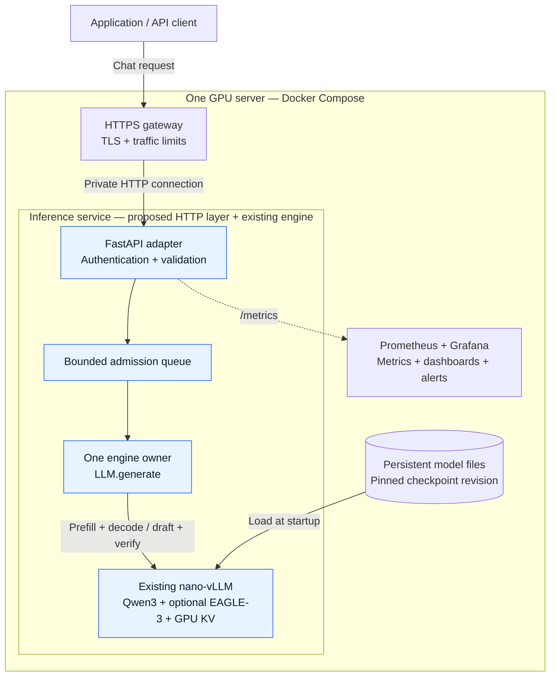
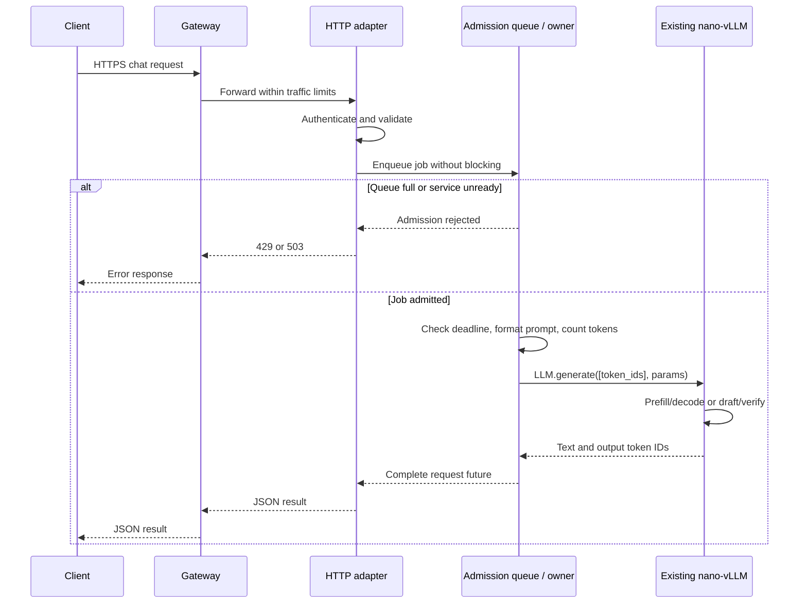
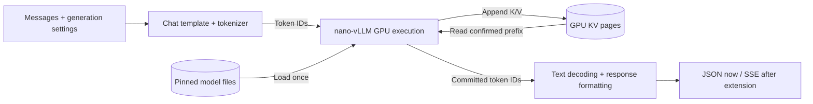

# Simple production deployment for LLM inference

This guide builds a small inference service around **the nano-vLLM code already
in this workspace**, including our optional EAGLE-3 implementation. The intended
first deployment is one model, one GPU, and controlled traffic, with Docker
Compose managing the processes.

The inference engine is implemented. The HTTP adapter, gateway configuration,
admission queue, metrics endpoint, and deployment files below are **proposed
additions**, not services already running. Configuration snippets illustrate
these boundaries; they are not a complete deployment bundle.

The first milestone returns a complete JSON response. Incremental streaming and
cooperative cancellation require small, explicit engine extensions described
below. This distinction matters because the current `LLM.generate()` returns
only after generation finishes.

## 1. What we reuse

| Existing code | Responsibility in the service |
| --- | --- |
| [LLMEngine](nano-vllm/nanovllm/engine/llm_engine.py) | Load the engine once; call `generate()`; close with `exit()` |
| [SamplingParams](nano-vllm/nanovllm/sampling_params.py) | Temperature, output-token budget, and EOS behavior |
| [Scheduler](nano-vllm/nanovllm/engine/scheduler.py) | Ordinary decoding: schedule prefill/decode, manage waiting/running sequences |
| [BlockManager](nano-vllm/nanovllm/engine/block_manager.py) | Ordinary decoding: allocate and reuse paged KV blocks |
| [ModelRunner](nano-vllm/nanovllm/engine/model_runner.py) | Load weights, warm up, allocate KV storage, and execute GPU work |
| [Qwen3 model](nano-vllm/nanovllm/models/qwen3.py) and [attention layer](nano-vllm/nanovllm/layers/attention.py) | Model math, FlashAttention, and the Triton KV-cache writer |
| [SpeculativeDecoder](nano-vllm/nanovllm/engine/speculative.py) and [EAGLE-3 head](nano-vllm/nanovllm/models/eagle3.py) | Optional draft/verify generation using the checkpoint we tested |
| [Comparison script](nano-vllm/speculative_example.py) and [tests](nano-vllm/tests/) | Check output behavior, acceptance, cache rollback, and performance before release |
| [Local setup](nano-vllm/LOCAL_SETUP.md) and [requirements](nano-vllm/requirements-h100.txt) | Reuse the working Python/PyTorch/FlashAttention combination |

Keep HTTP, authentication, and deployment concerns outside `nanovllm/models/` and
`nanovllm/layers/`. That keeps the engine readable and lets the same engine run
from a CLI, a test, or a service.

## 2. Component diagram

There are four proposed container services: gateway, inference, Prometheus, and
Grafana. The API, admission queue, and engine owner live inside the inference
service. They are logical components, not three model replicas.



Results return through owner → API → gateway → client. In the streaming extension,
committed output chunks follow that same path as they become available.

## 3. Client: describe the work and own the connection

The client sends messages, chooses an output budget, and handles completion,
failure, or cancellation. Conversation history belongs to the application: each
chat request supplies the messages needed to reconstruct its prompt. A GPU KV
cache is not a persistent conversation database.

A small initial contract can resemble the chat-completions API:

```json
{
  "model": "qwen3-0.6b",
  "messages": [{"role": "user", "content": "Explain how a KV cache works."}],
  "temperature": 0,
  "max_tokens": 128,
  "stream": false
}
```

Treat this as a supported subset: one completion, text messages, temperature,
and a token limit. Reject unsupported tools, multimodal input, or sampling
parameters rather than silently ignoring them. An endpoint with this path is
not automatically a complete OpenAI-compatible implementation.

The client should set an overall deadline and close the connection when the user
cancels. A request ID helps correlate logs; it does not make generation idempotent.
Retries can duplicate GPU work. In a future streaming API, retrying after some
text has arrived starts a new generation unless the application implements a
separate continuation protocol.

## 4. Gateway: control access to the server

The gateway is the public network boundary. Use it for TLS certificates, request
body limits, coarse rate limits, and forwarding to the private inference service.
For this small design, the API adapter validates bearer API keys before admission;
the gateway forwards the authorization header over the private connection.

Publish the HTTPS port. Keep the inference port and operational endpoints private.
Only expose the routes intended for clients. Keep credentials in configuration
or secrets, and log request metadata rather than authorization headers.

An NGINX location for the eventual streaming path would include:

```nginx
# Fragment inside a server block; TLS, authentication in the API, and rate-limit
# zones are configured separately. "inference" is a Compose service name.
location /v1/ {
    proxy_pass http://inference:8000;
    proxy_http_version 1.1;
    proxy_set_header X-Request-ID $request_id;
    proxy_buffering off;
    proxy_read_timeout 120s;
    proxy_ignore_client_abort off;
    proxy_next_upstream off;
}
```

`proxy_buffering off` allows incremental responses to reach the client promptly.
The read timeout measures the gap between upstream reads, not the whole request
duration. Closing an upstream connection on client disconnect does not itself
stop a synchronous GPU generation; the application must also implement
cancellation. See the [NGINX proxy documentation](https://nginx.org/en/docs/http/ngx_http_proxy_module.html).

The shown timeout is illustrative. Align it with queue-wait and generation
deadlines. Requests per second alone cannot describe load: ten requests for
sixteen output tokens cost much less than ten requests for thousands of tokens.
Combine gateway limits with token budgets and a bounded queue in the service.

## 5. HTTP adapter: translate an API request into engine work

FastAPI is a suitable small adapter. It owns request parsing, authentication,
response formatting, request IDs, and admission decisions. It should call the
existing engine through one controlled worker interface.

Proposed routes:

| Route | Behavior to implement |
| --- | --- |
| `POST /v1/chat/completions` | Validate, enqueue, await completion, format the result |
| `GET /v1/models` | Return the configured model name and revision |
| `GET /healthz` | Report that the HTTP process is responsive |
| `GET /readyz` | Report that model startup/warmup succeeded and the worker is usable |
| `GET /metrics` | Expose service instrumentation to Prometheus |

These routes do **not** currently exist in nano-vLLM. They belong in the new adapter.

Perform cheap checks before enqueueing: nonempty message list, supported roles,
string content, finite temperature within the service policy, a positive integer
output budget, and a recognized model. The owner then applies the exact Qwen
chat template and validates the resulting token count before GPU execution.

Keep blocking `LLM.generate()` off the asynchronous HTTP event loop so health
checks and admission remain responsive. Use a dedicated owner thread and a
thread-safe queue, with a safe bridge back to the request's async future. Creating
many HTTP tasks must not create concurrent calls into the same engine. See
[FastAPI concurrency](https://fastapi.tiangolo.com/async/).

Initialize the owner during application startup, wait for its warmup, and close
it during shutdown through the application's lifecycle management. See
[FastAPI lifespan](https://fastapi.tiangolo.com/advanced/events/).

## 6. Admission queue and engine owner: bound the work

Use one long-lived `LLM` object, constructed, called, and closed by the same
dedicated owner. The HTTP process can handle concurrent connections while the
owner executes one generation job at a time.

This is required by our implementation: [context.py](nano-vllm/nanovllm/utils/context.py)
stores global mutable attention metadata, while the engine mutates scheduler
queues, sequence state, and GPU caches. Parallel `generate()` calls on that
object can corrupt those assumptions. A shared general-purpose thread pool is
not an engine ownership protocol.

A bounded in-memory queue makes the overload behavior explicit. For example,
start by testing one executing request and at most four waiting requests; these
are bring-up settings, not measured capacity limits. Use nonblocking admission
and return an overload response when the queue is full. Also bound request body
size so a few queued jobs cannot consume unlimited host memory.

Each job needs a request ID, validated input, deadline, completion future, and
cancellation flag. A queued job that expires or is cancelled should be skipped.
Reject new work while the owner is unavailable or the service is draining.

There are two distinct queues in the ordinary path:

| Queue | What it contains | Purpose |
| --- | --- | --- |
| Service admission queue, proposed | HTTP generation jobs | Bound waiting work and enforce deadlines |
| Existing `Scheduler.waiting` / `running` | Engine sequences | Choose prefill/decode work and manage KV blocks |

With one prompt per `generate()` call, service jobs execute sequentially. The
ordinary engine can already batch a list of prompts within one call; a later
owner can collect compatible jobs into small batches. That does not automatically
provide continuous admission from HTTP while `generate()` is already running.
Our current EAGLE-3 path processes prompt lists sequentially and bypasses the
ordinary scheduler.

If a later version admits jobs between engine steps, also review fairness: the
current ordinary scheduler prioritizes waiting prefills. A steady arrival stream
must not indefinitely delay decode work for requests already generating.

Use one Uvicorn worker for this first deployment. Multiple server worker processes
would each initialize their own model; our runner also uses a fixed local NCCL
rendezvous port. Scale with explicitly assigned GPU replicas and separate process
boundaries rather than increasing HTTP workers blindly. See
[FastAPI server workers](https://fastapi.tiangolo.com/deployment/server-workers/).

## 7. Inference engine: reuse the model execution code

### Ordinary decoding and EAGLE-3

Choose a mode at service startup:

| Mode | Existing implementation | Relevant serving behavior |
| --- | --- | --- |
| Ordinary | `LLMEngine`, `Scheduler`, `ModelRunner` | Supports prompt batches and the existing paged block manager |
| EAGLE-3 | `SpeculativeDecoder`, `Eagle3`, target `ModelRunner` | One GPU, sequential requests, separate draft KV storage; eager by default with optional dedicated CUDA graphs |

The EAGLE path accepts `generate()` and exposes `speculative_stats`. Its
`add_request()` / `step()` interface is explicitly unsupported. Treat the two
modes as separately configured service instances when benchmarking or rolling
out; avoid switching a live engine between cache ownership models.

Our optional speculative captures are enabled at startup with
`speculative_cuda_graphs=True`; see the
[implementation and comparison guide](nano-vllm/SPECULATIVE_CUDA_GRAPHS.md).
Kernel backends and graph flags are deployment settings. The public request
contract remains the same for ordinary and EAGLE execution.

### A small worker function using our current API

The following code is an initialization/work-function sketch, to execute in the
engine-owner thread. `MODEL_PATH` and optional `DRAFT_MODEL_PATH` are local
checkpoint paths. The HTTP handler submits a job that invokes `run_chat`; it
does not invoke this function concurrently itself.

```python
import os
from nanovllm import LLM, SamplingParams

MAX_CONTEXT = 4096
MAX_OUTPUT = 512

llm = LLM(
    os.environ["MODEL_PATH"],
    draft_model=os.environ.get("DRAFT_MODEL_PATH") or None,
    num_speculative_tokens=3,
    tensor_parallel_size=1,
    enforce_eager=True,
    max_num_seqs=1,
    max_model_len=MAX_CONTEXT,
    max_num_batched_tokens=MAX_CONTEXT,
    gpu_memory_utilization=0.2,
)

def run_chat(messages, temperature=0.0, max_tokens=128):
    # Structural/types/finite-value validation happens in the HTTP adapter.
    if not 1 <= max_tokens <= MAX_OUTPUT:
        raise ValueError("Output-token budget is outside service policy")
    token_ids = llm.tokenizer.apply_chat_template(
        messages, tokenize=True, add_generation_prompt=True,
        enable_thinking=False,
    )
    if len(token_ids) + max_tokens > MAX_CONTEXT:
        raise ValueError("Prompt and output budget exceed the context limit")
    params = SamplingParams(temperature=temperature, max_tokens=max_tokens)
    return llm.generate([token_ids], params, use_tqdm=False)[0]

# Owner lifecycle: warm up before readiness; call llm.exit() during shutdown.
```

This reuses the same chat formatting, constructor options, sampling parameters,
and output dictionaries as our [comparison script](nano-vllm/speculative_example.py).
Disabling thinking mode makes the initial text API easier to inspect. If thinking
mode is later exposed, account for its generated tokens and define how reasoning
content is represented in the response.

The context check is an API-layer responsibility as well as an engine concern:
the ordinary engine does not currently enforce this whole request budget at
admission. Include chat-template and special tokens in the count.

### GPU memory explains concurrency limits

The worker needs VRAM for weights, KV storage, temporary tensors, and runtime
workspaces. For this Qwen3-0.6B configuration with BF16 K/V, raw KV bytes per token
are approximately:

```text
2 × 28 layers × 8 KV heads × 128 dimensions × 2 bytes = 112 KiB/token
```

A fully cached 4,096-token sequence therefore needs roughly 448 MiB of raw KV;
sixteen such sequences need roughly 7 GiB, before other storage. This is a
capacity calculation, not a throughput prediction.

`gpu_memory_utilization` controls the cache-sizing budget in our runner; it is
not GPU isolation from other users. Reserve the intended physical GPU explicitly.
The example's 0.2 follows our cautious local setup and needs load testing for the
actual service. Quantizing weights does not automatically quantize this KV cache.

## 8. Model storage: make startup reproducible

Reuse this machine's shared cache at
`/mnt/dtgroupstorage/Hieu_Cao/hf_cache`, rather than downloading weights for each
request or rebuilding a second copy for the API. Load the selected local snapshot
once at startup. Record the engine code revision, exact package versions, model
revision, tokenizer/chat template, and serving settings as one release.

Our tested target revision is
`Qwen/Qwen3-0.6B@c1899de289a04d12100db370d81485cdf75e47ca`.
The draft revision is
`GavinLucky/SGLang-EAGLE3-Qwen3-0.6B-SpecForge@5fe9c43a50078119bfa38e5f30969475be314315`.
Reuse the cache resolution approach in `speculative_example.py` during artifact
preparation, then use explicit local paths and offline loading at service startup.

Hugging Face snapshot entries in our cache are relative symlinks into `blobs/`.
Mount the whole cache read-only, preserving that layout, or package a self-contained
snapshot with links resolved. Mounting only the snapshot directory can leave the
container with broken links. Give compilation/runtime caches a separate writable
location; they are different from the immutable model artifacts.

The three kinds of storage have different lifetimes:

| Storage | Location | Survives an inference-container restart? |
| --- | --- | --- |
| Checkpoint, tokenizer, config | Persistent disk volume | Yes |
| Loaded model weights and KV pool | GPU memory | No; recreate them at startup |
| Metrics history and saved dashboards | Prometheus/Grafana volumes | Yes, if configured |

The existing inference engine stores prefix/KV state in memory. It does not
persist that state as chat history, and a model revision change invalidates any
assumption that old cached features can be reused.

## 9. Monitoring: observe service behavior and engine behavior

Add a Prometheus endpoint to the HTTP adapter. nano-vLLM currently prints progress
and exposes completed speculative statistics; it has no `/metrics` endpoint.
Prometheus collects measurements, Grafana displays them, and configured alert
rules notify an operator. Store their data on persistent volumes and define
retention so monitoring does not fill the server's disk.

Start with a small custom metric set. The names below are a proposed service
contract, not metrics already emitted by the engine:

| Metric | Measurement point | What it explains |
| --- | --- | --- |
| `nano_llm_queue_depth` | Admission queue | Whether demand exceeds execution capacity |
| `nano_llm_inflight_requests` | Owner, normally 0 or 1 initially | Whether generation is running |
| `nano_llm_queue_wait_seconds` | Enqueue to owner start | Time lost waiting for the model |
| `nano_llm_generation_seconds` | Around `LLM.generate()` | Engine job duration, excluding queue wait |
| `nano_llm_request_seconds` | API accept to response completion | User-facing server latency |
| `nano_llm_output_tokens_total` | Completed output token IDs | Aggregate generated-token throughput |
| `nano_llm_requests_total` | API completion/rejection, by outcome | Successes, overload, validation failures, cancellations |
| `nano_llm_draft_proposed_tokens_total` / `nano_llm_draft_accepted_tokens_total` | `llm.speculative_stats` after each job | Whether draft work is being accepted |

Use bounded labels such as model, decoding mode, and outcome. Keep individual
request IDs in structured logs rather than metric labels. Log token counts,
queue/generation durations, selected release, and failure type; full prompts and
the draft's per-round token traces should be an explicit debugging choice.

Reuse `speculative_stats` for accepted/proposed totals and internal prefill/decode
timings. Those internal timings do not include service queue delay. Before true
streaming exists, the client receives its first response only after the whole
generation: do not call the internal prefill time client-visible TTFT.

After adding incremental events, measure time to first token from API admission
to the first committed chunk, and measure subsequent output gaps. Client-side
measurements additionally include network/proxy delays. GPU utilization and
temperature need a GPU telemetry source, such as an exporter; they are not
provided by these proposed Python counters.

Useful initial alerts are persistent queue saturation, repeated job failures,
readiness remaining false after startup, and a running job exceeding its allowed
deadline. Choose numerical thresholds after measuring representative workloads.

## 10. Container lifecycle: load once, become ready, drain, restart

Reuse the working environment described in
[LOCAL_SETUP.md](nano-vllm/LOCAL_SETUP.md): Python 3.12, PyTorch 2.6, and the matching
FlashAttention wheel. Its requirements file includes some version ranges, so
capture an exact dependency lock for the service build rather than treating that
file as a complete reproducibility guarantee. Pin the final image digest and add
the HTTP/metrics packages to that service lock.

Docker packages the service environment; it does not isolate one GPU's memory
between competing processes automatically. Give the inference container access
only to its assigned GPU and keep the gateway/monitoring services CPU-only. Keep
the tutorial and quantization environments separate from the serving image.

### Startup sequence

1. Verify that the pinned artifact files and assigned GPU are available.
2. Start the API process with readiness false and create the owner thread.
3. In the owner, construct `LLM`: the existing runner loads weights, warms up,
   and allocates KV storage. EAGLE additionally loads the draft weights/cache.
4. Run a short generation through the same public method used by service jobs.
   This exercises shapes and compilation paths that model-only warmup can miss.
5. Mark readiness true and admit requests through the gateway.

A responsive HTTP process is not evidence that weights loaded successfully.
Expose liveness and readiness separately. Reuse the application's lifecycle
manager to coordinate owner initialization and shutdown.

Compose can wait for a dependency's successful health check with
`depends_on: condition: service_healthy`. That gates initial startup; it does not
provide continuous request routing away from unhealthy backends. Implement later
health transitions in admission/gateway behavior as well. See
[Compose startup order](https://docs.docker.com/compose/how-tos/startup-order/).

### Shutdown and failure

On shutdown, stop admission, mark the instance unready, and drain accepted work
up to a bounded deadline. Close the engine with `llm.exit()` from the owner, then
exit the process. Set container termination grace long enough for that policy.

A Docker restart policy handles process exits. An `unhealthy` status alone does
not make a normal Compose container restart. A stuck owner may require a watchdog
that terminates the failed process so the restart policy can act. Do not create a
second live engine thread while the original one may still be executing CUDA.
See [Docker restart policies](https://docs.docker.com/engine/containers/start-containers-automatically/).

After a CUDA failure, treat the owner as unavailable and recover the process
before accepting more jobs. Pending jobs live in memory, so container failure
also loses them; clients need a clear failure response/retry policy.

## 11. Follow one request through the service

This is the initial complete-response path. Authentication and cheap validation
occur before a job consumes a queue slot; exact prompt-token validation happens
in the owner before model execution.



The data being moved is different at each boundary:



## 12. Streaming and cancellation: the next engine extensions

The gateway configuration can forward SSE, but it cannot create incremental
events from a function that returns only at the end. Sending an entire completed
answer through a streaming HTTP response would still have full-generation first
token latency.

### Incremental events

For ordinary decoding, `step()` already advances execution, but currently returns
only completed sequences. Add a small event interface after scheduler
postprocessing that reports newly committed token IDs and their sequence IDs.
Return a request/sequence handle from admission so the adapter can correlate
engine events with HTTP requests.

For EAGLE-3, extend `_generate_one()` to emit the first target token and then each
**committed** `emitted` block after verification and EOS/budget truncation. Never
send unverified draft proposals. The emitted block may contain multiple tokens;
clients should not assume one event equals one token.

The owner passes immutable event data to the API, which performs SSE formatting.
Use an incremental text decoder or stable-prefix buffering: decoding individual
token IDs independently can break text boundaries or incomplete Unicode. Bound
outbound event buffers and cancel consistently slow consumers so they cannot
accumulate unlimited memory while the GPU runs.

### Cooperative cancellation

Closing a socket or cancelling an async future does not interrupt the current
`generate()` call. For the complete-response milestone, cancelled running work
may continue to its bounded output limit; only queued work can be skipped without
an engine extension.

Add a cancellation/deadline check at safe engine boundaries: between normal
steps or speculative verification rounds. The owner must perform cleanup. In the
ordinary path, remove the sequence from the correct scheduler queue and release
its block references through `BlockManager`. The speculative path owns static
cache storage and must stop with consistent logical lengths/context; the next
request starts from its own prefix. Do not free or mutate GPU cache state from
the HTTP event-loop thread.

Keep the current EAGLE regression checks. The existing long BF16 diagnostic found
a rounded-logit tie that changed a greedy choice between batched verification and
single-token decoding; the comparison reports this rather than claiming universal
bitwise equivalence. See the
[speculative decoding guide](nano-vllm/SPECULATIVE_DECODING.md#observed-results-and-numerical-limit).

## 13. Failure behavior to define before exposing the service

| Situation | Desired service behavior | Work needed |
| --- | --- | --- |
| Missing/invalid credential | Reject before queueing | API authentication |
| Empty input, unsupported field, invalid budget | Return a clear client error | Schema and token-budget validation |
| Full admission queue | Reject promptly, e.g. 429 | Bounded nonblocking queue |
| Model loading or worker unavailable | Return 503; readiness false | Owner lifecycle/readiness state |
| Queued request exceeds deadline | Remove/skip without GPU work | Job deadline/cancellation handling |
| Running request disconnects | Stop at a safe boundary after extension | Cooperative engine cancellation |
| GPU error or stuck execution | Withdraw readiness and recover process | Worker failure reporting/watchdog |
| Failure after some SSE text | Report/close the stream; avoid automatic replay | Streaming error protocol |
| Container or host failure | In-memory jobs and KV are lost | Client policy and additional replicas for availability |

Once streaming response headers have been sent, a later failure cannot become a
fresh HTTP 503 response. Define a terminal stream error event or document that an
unexpected close means incomplete output.

## 14. Build order and verification

Implement the smallest useful service in stages:

1. **Complete-response adapter:** one owner, bounded queue, supported request
   schema, API key validation, deadlines, and JSON responses. Reuse the existing
   engine without rewriting model layers.
2. **Operations:** health/readiness, structured logs, custom metrics, gateway TLS,
   and reproducible container build with pinned local artifacts.
3. **Incremental execution:** add committed-token events and cancellation to the
   ordinary and EAGLE paths, then expose `stream: true` through the gateway.
4. **Capacity improvements:** measure compatible microbatches in ordinary mode,
   compare EAGLE on actual prompts, and add explicitly provisioned replicas.

Keep proposed service files separate from the inference internals, for example
`nano-vllm/deployment/server.py`, `worker.py`, `metrics.py`, `Dockerfile`,
`compose.yaml`, and `nginx.conf`. These are a suggested layout; they are not
created by this documentation update.

Before a first release, verify:

- A direct `LLM.generate()` call and the API produce the same greedy output for
  the same tokenized input, release, and decoding mode.
- Burst traffic fills the configured queue and rejects excess requests without
  blocking health checks or creating a second model instance.
- Invalid messages, excessive output budgets, and oversized tokenized prompts
  are rejected before GPU execution.
- Slow startup stays unready until model initialization and generation warmup
  complete; a failed owner does not continue accepting requests.
- EOS, generation budgets, and repeated requests release/reuse engine state
  correctly. Reuse our existing cache-rollback and EAGLE tests.
- After the streaming extension, first chunks arrive before completion, rejected
  proposals never reach clients, and disconnects stop work at safe boundaries.
- Shutdown drains according to policy; process restart reloads the same model
  revision; a previous image/configuration can be restored.

Use [speculative_example.py](nano-vllm/speculative_example.py) for the inference
baseline and add HTTP load tests for queue wait, complete response latency, and
failure rates. Measure realistic prompt/output lengths. Single-request speed and
aggregate service throughput answer different questions.

For updates on one replica, schedule a maintenance window or accept downtime while
draining and reloading. For continuity, bring a second replica up, verify it,
shift new requests, and drain the old replica. Host-failure tolerance requires
replicas on separate hosts. Each replica owns its own GPU cache; there is no KV
sharing in this design.

The remaining deployment choices are the hostname/TLS setup, API-key management,
selected decoding mode, traffic/token limits, measured latency targets, and the
GPU allocation. They tune this architecture without changing the reused model
implementation.

## 15. Interface contracts between components

An interface defines the data crossing a boundary, how it is delivered, who owns
the work, how failure is reported, and when resources are released. Define these
contracts before implementing the proposed adapter. They let the gateway, HTTP
layer, owner and metrics code evolve while reusing the engine unchanged.

The contracts below describe the first complete-response milestone. The Python
types are design examples for future service files; no new server or queue is
implemented by this document. API, queue and owner communicate within one process.

### Boundary map

| Boundary | Interface and data | Owner and completion rule |
| --- | --- | --- |
| Client → gateway → API | HTTPS externally, private HTTP internally; JSON chat request, bearer credential, request ID | API authenticates and validates; one JSON result or error completes the request |
| API → admission queue | Nonblocking `submit(GenerationJob) -> Future[GenerationResult]` | Queue owns an accepted work item until the owner takes it; rejects full/unready admission immediately |
| Queue → engine owner | Thread-safe FIFO of job, completion future and cancellation flag | One owner claims each job once; skips expired/cancelled queued work |
| Owner → existing engine | Chat template/tokenizer, `SamplingParams`, `LLM.generate([token_ids], ...)` | Owner alone constructs, calls and closes the engine; result contains text and output token IDs |
| Service → monitoring | Metrics registry and private `GET /metrics`; structured logs with request IDs | HTTP scrapes read a snapshot; they never call the model; GPU telemetry comes from a separate source |
| Storage → owner | Read-only local checkpoint paths plus a pinned release manifest | Owner validates artifacts at startup and loads once; GPU weights/cache belong to that owner |

The model layers and kernels remain Python/CUDA implementation details inside
the engine. They do not need separate HTTP endpoints. Ordinary/EAGLE selection,
Q/K fusion and CUDA graph settings are fixed for the owner at startup.

### Public HTTP contract

`POST /v1/chat/completions` accepts the JSON shape shown in section 3. Define its
supported fields precisely: `model`, text `messages`, finite nonnegative
`temperature` within service policy, bounded positive `max_tokens`, and
`stream: false`. Unknown fields and `stream: true` return an unsupported-input
error in this milestone. Model names are public aliases, not checkpoint paths.

The gateway forwards the body and authorization header, sets `X-Request-ID`, and
returns the upstream response. The API owns authentication, generation-parameter
validation and response formatting. Use a bounded, validated request ID in the
internal job, response header and logs. Retries create new work; this ID is for
correlation, not deduplication.

A successful response has this supported shape:

```json
{
  "id": "req_123",
  "object": "chat.completion",
  "model": "qwen3-0.6b",
  "choices": [{
    "index": 0,
    "message": {"role": "assistant", "content": "A KV cache reuses prior attention keys and values."},
    "finish_reason": "stop"
  }],
  "usage": {"prompt_tokens": 24, "completion_tokens": 12, "total_tokens": 36}
}
```

The usage counts above are illustrative. The owner supplies actual token counts,
including chat-template tokens. This is the documented subset for our service;
it does not claim complete compatibility with another provider's API.

### API, queue and owner data types

Keep the job payload immutable and CPU-only. A separate private work item holds
the payload, a `concurrent.futures.Future`, and a `threading.Event` for cancellation.
The HTTP coroutine can await the future through an async bridge; the owner sets
the result or exception from its thread.

```python
from concurrent.futures import Future
from dataclasses import dataclass
from typing import Literal, Protocol

@dataclass(frozen=True)
class Message:
    role: Literal["system", "user", "assistant"]
    content: str

@dataclass(frozen=True)
class GenerationJob:
    request_id: str
    model: str
    messages: tuple[Message, ...]
    temperature: float
    max_tokens: int
    admitted_ns: int
    deadline_ns: int

@dataclass(frozen=True)
class GenerationResult:
    request_id: str
    text: str
    token_ids: tuple[int, ...]
    prompt_tokens: int
    finish_reason: Literal["stop", "length"]

class Admission(Protocol):
    def submit(self, job: GenerationJob) -> Future[GenerationResult]: ...
```

`submit()` either returns the future of accepted work or raises a typed admission
error such as `queue_full` or `not_ready`. It never waits for a free queue slot.
The future resolves exactly once with a result or typed failure, except when
cancelled before execution. The work-item implementation must coordinate claiming
and cancellation atomically; `Future.set_running_or_notify_cancel()` supports
this distinction. A cancelled work item can occupy its queue slot until the
owner removes it; queue-depth accounting should reflect the actual buffer.

`admitted_ns` and `deadline_ns` use the same process's monotonic clock. The API
computes the effective deadline from server policy when admitting work; the
owner checks it before tokenization and again before `generate()`. This clock
is for elapsed time within the service, not a timestamp to subtract from a
client's clock. A gateway timeout does not extend this deadline.

Before execution, queued cancellation or expiry skips the GPU call. Once running,
the current engine completes to its bounded budget even if the client disconnects
or its deadline expires. The API can abandon the response, but the owner remains
busy until that call returns. Cooperative interruption is the section 12 extension.
Do not free GPU state or start another generation from the HTTP thread.

### Owner-to-engine adapter

The owner converts the job's messages to the dictionaries accepted by the existing
chat template, tokenizes, and validates the exact prompt/output budget. Then it
reuses the current call:

```python
params = SamplingParams(temperature=job.temperature, max_tokens=job.max_tokens)
output = llm.generate([prompt_token_ids], params, use_tqdm=False)[0]
# output["text"]: str; output["token_ids"]: list[int]
```

The adapter copies token IDs into the result tuple, records prompt/output counts,
and formats the public response. With EOS respected, it derives `finish_reason`
from the last token and output budget: EOS means `stop`, budget exhaustion means
`length`. The current engine does not return this field directly. Unexpected
early termination should be treated as an engine failure rather than silently
inventing a successful stop reason.

GPU tensors, KV pointers and mutable attention context stay inside the owner.
Capture completed `speculative_stats` immediately after that job, before the next
call replaces them. Export aggregate statistics; keep the detailed per-round
token trace only when explicitly debugging. Both engine modes return the same
service-level `GenerationResult`.

### Failure and lifecycle contract

Map internal failures to a stable response envelope:

```json
{"error": {"code": "queue_full", "message": "The admission queue is full.", "request_id": "req_123"}}
```

| Internal condition | Proposed HTTP result | Execution effect |
| --- | --- | --- |
| Invalid credential | 401 / `unauthorized` | No admission |
| Invalid/unsupported input or token budget | 400 / `invalid_request` | No GPU work |
| Unknown public model alias | 404 / `model_not_found` | No admission |
| Full queue | 429 / `queue_full` | No accepted job |
| Owner loading, draining or failed | 503 / `not_ready` | Reject new work |
| Deadline expires while awaiting a result | 504 / `deadline_exceeded` | Skip if queued; running work follows the bounded-completion rule above |
| Fatal CUDA/owner failure | 503 / `engine_unavailable` | Mark unready, fail pending futures and recover the process |

Gateway-generated errors may have their own envelope; the proxy configuration
must normalize those separately if clients require one shape for every failure.
Error bodies contain stable public codes, not raw CUDA stack traces. Returning
an error does not guarantee that a disconnected or running job consumed no work.

The owner state transitions are `STARTING → READY → DRAINING → STOPPED`, with a
transition to `FAILED` on fatal error. Only `READY` accepts new jobs. Startup
loads the release and runs warmup before readiness; draining stops admission,
handles queued/running work within the shutdown policy, then calls `llm.exit()`
from the owner. `/healthz` checks HTTP liveness; `/readyz` reflects owner state.

### Metrics, tracing and storage contracts

Assign each duration a boundary: queue wait is admission to owner claim,
tokenization is owner preparation, generation brackets `LLM.generate()`, and
server request time brackets HTTP handling through response completion. Record
terminal outcomes exactly once for each request and each engine job separately:
a disconnected request can finish before its running job completes. Keep request IDs in logs and
traces; use bounded model/mode/outcome labels for metrics. Monitoring reads
published snapshots rather than touching the engine from the scrape thread.

Optional detailed engine spans identify prefill, draft repair, rollout,
verification and sampling. CPU monotonic durations describe elapsed work around
those boundaries; GPU kernel timing uses CUDA-aware profiling. With captured
graphs, place request-time ranges around replay, since Python executed during
capture is not re-executed on every replay. These hooks remain proposed additions.

The release manifest supplies the model alias, local target/draft snapshot paths
and revisions, tokenizer/chat-template choice, package/code versions, dtype,
context/output limits and execution flags. The owner validates this configuration
before becoming ready. Model files are mounted read-only; compilation caches have
a separate writable location. A release change uses drain/reload or a new replica,
and readiness never reports a partially loaded release as usable.

### Verify the contracts before wiring the full service

- Use a fake engine to check queue capacity, deadlines, cancellation races,
  exactly-once future completion and readiness transitions without a GPU.
- Check supported HTTP request/result/error schemas and consistent request IDs.
- Confirm an adapter job and a direct engine call produce the same result for
  identical token IDs and settings; reuse existing GPU regression checks.
- Confirm monitoring stays responsive during generation and that queue wait,
  tokenization and generation durations have the boundaries specified above.
- Verify that a running disconnect does not allow a second engine call, and
  that drain/failure paths settle accepted futures and close the owner safely.

Start with these Python contracts inside the existing single inference service.
If the owner later moves to another process or host, serialize the job/result
payloads and define acknowledgments, retry/idempotency and transport failure
semantics at that new boundary. The current in-memory future is process-local.
